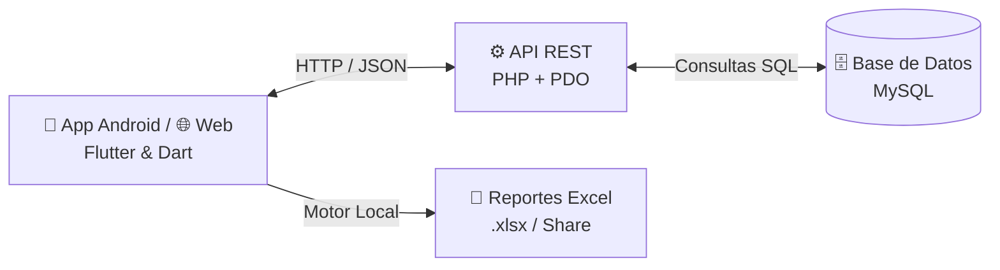

<div align="center">
  

  <h1>⚙️ MINA-OPS — Control de Horómetros</h1>

  <p>
    <strong>Sistema multiplataforma para el registro, control operativo y reportabilidad de horómetros en maquinaria minera.</strong>
  </p>

  <p>
    
    
    
    
    
    
  </p>

  <p>
    <a href="#-descripción-general">Descripción</a> •
    <a href="#-vista-previa">Vista Previa</a> •
    <a href="#-funcionalidades-clave">Funcionalidades</a> •
    <a href="#-arquitectura-del-sistema">Arquitectura</a> •
    <a href="#-instalación-y-despliegue">Instalación</a> •
    <a href="#-seguridad">Seguridad</a>
  </p>
</div>

---

## 📋 Descripción General

En operaciones mineras, el control manual de horómetros suele generar retrasos en la consolidación de horas trabajadas, errores de digitación y pérdida de trazabilidad por zona.

**MINA-OPS** resuelve este problema mediante una aplicación móvil (**Android**) y **Web** conectada en tiempo real a un backend centralizado. Permite digitalizar las lecturas diarias de equipos auxiliares (torres de iluminación `CO-TI`, grupos electrógenos `CO-GE` y maquinaria auxiliar), calcular horas operadas automáticamente y emitir reportes consolidados en **Excel (`.xlsx`)** listos para supervisión y facturación.

---

## 📸 Vista Previa

<div align="center">

| Dashboard Operativo | Registro de Horómetro | Gestión de Equipos | Reportes Excel |
| :---: | :---: | :---: | :---: |
|  |  |  |  |

</div>

---

## ✨ Funcionalidades Clave

| Módulo | Capacidades Principales |
| :--- | :--- |
| **📊 Dashboard Operativo** | Panel diario de horas operadas, tarjetas KPI (*Lecturas*, *Equipos* y *Promedio*), cinta de navegación semanal y listado de lecturas del día. |
| **⏱️ Registro de Horómetros** | Precarga automática del horómetro inicial, cálculo en vivo de horas del turno, accesos rápidos (*Hoy / Ayer*) y enlace directo para dar de alta equipos nuevos sin perder el flujo. |
| **🚜 Gestión de Equipos** | Alta rápida en catálogo de maquinaria mediante código interno (`CO-TI-05`, `CO-GE-08`, etc.), horómetro base inicial y área/zona de operación. |
| **📑 Exportación a Excel** | Generación de hojas de cálculo (`.xlsx`) con detalle y resumen en dos modalidades: **descarga por fecha específica** (*Hoy / Ayer* o calendario) y **descarga histórica completa**. |
| **☁️ Sincronización Cloud** | Sincronización en tiempo real con base de datos MySQL mediante API REST en PHP y botón de actualización manual en cabecera. |
| **📱 Diseño Responsivo** | Interfaz industrial adaptable a dispositivos Android y navegadores web con control de escala tipográfica. |

---

## 🏛️ Arquitectura del Sistema



<details>
<summary><strong>📂 Ver estructura de carpetas del proyecto</strong></summary>

```text
control_horom/
├── assets/
│   └── log.jpg                         # Ícono oficial y branding de la aplicación
├── docs/
│   └── screenshots/                    # Capturas de pantalla para documentación
├── lib/
│   ├── core/
│   │   ├── api_service.dart            # Cliente HTTP para consumo de la API REST
│   │   ├── app_theme.dart              # Paleta corporativa y configuración de tema
│   │   ├── date_utils_mina.dart        # Utilidades de formato y semanas operativas
│   │   └── responsive.dart             # Breakpoints y adaptación móvil/web
│   ├── models/
│   │   ├── equipo.dart                 # Entidad Equipo (código, tipo, zona, estado)
│   │   └── registro_horometro.dart     # Entidad Lectura de Horómetro
│   ├── state/
│   │   └── mina_controller.dart        # Gestión de estado (ChangeNotifier) y reglas de negocio
│   ├── ui/
│   │   ├── screens/
│   │   │   ├── dashboard_screen.dart           # Panel de KPIs y resumen operativo
│   │   │   ├── registro_horometro_screen.dart  # Formulario de captura con validaciones
│   │   │   ├── registro_equipo_screen.dart     # Catálogo y alta de equipos
│   │   │   └── reportes_screen.dart            # Generación y exportación a Excel
│   │   └── home_shell.dart             # Navegación principal (NavigationBar)
│   └── main.dart                       # Punto de entrada y configuración global
└── pubspec.yaml
```

</details>

<details>
<summary><strong>🔌 Ver contrato de la API REST</strong></summary>

| Método | Endpoint | Descripción |
| :--- | :--- | :--- |
| `GET` | `/api.php` | Retorna el historial completo de lecturas y equipos registrados en formato JSON. |
| `POST` | `/api.php` | Registra una nueva lectura de horómetro o ejecuta acciones de mantenimiento de registros. |

**Ejemplo de payload `POST`:**
```json
{
  "codigo": "CO-TI-05",
  "area_zona": "TRAMO I",
  "estado": "OPERATIVO",
  "fecha_registro": "2026-11-19",
  "observacion": "Operación normal turno día",
  "horometro": 1452.5
}
```

</details>

---

## 🛠️ Stack Tecnológico

* **Framework & Lenguaje:** Flutter · Dart (`SDK ^3.11.1`)
* **Red & Datos:** `http` · API REST en PHP (PDO) · MySQL
* **Exportación de Documentos:** `excel` · `path_provider` · `share_plus`
* **Branding & Empaquetado:** `flutter_launcher_icons`

---

## 🚀 Instalación y Despliegue

### Requisitos previos
* Flutter SDK instalado y configurado (`flutter doctor` sin errores).
* Servidor web con PHP 8+ y MySQL para alojar el backend.

### 1. Clonar e instalar dependencias

```bash
git clone [https://github.com/tu-usuario/control_horom.git](https://github.com/tu-usuario/control_horom.git)
cd control_horom
flutter pub get
```

### 2. Ejecutar en desarrollo (sin exponer credenciales)

Configura el endpoint en `lib/core/api_service.dart` o pásalo como variable de entorno en tiempo de ejecución:

```bash
flutter run --dart-define=API_URL=[https://tu-dominio.com/api.php](https://tu-dominio.com/api.php)
```

### 3. Compilar para Producción

```bash
# Generar APK universal para Android
flutter build apk --release --dart-define=API_URL=[https://tu-dominio.com/api.php](https://tu-dominio.com/api.php)

# Generar compilación para despliegue Web
flutter build web --release --dart-define=API_URL=[https://tu-dominio.com/api.php](https://tu-dominio.com/api.php)
```

El instalador de Android se generará en `build/app/outputs/flutter-apk/app-release.apk`.

---

## 🔒 Seguridad

* Las credenciales de conexión a MySQL y la URL productiva de la API se mantienen **excluidas del repositorio**.
* Para entornos productivos se recomienda aislar la configuración del servidor en un archivo `config.php` ignorado mediante `.gitignore` e implementar autenticación mediante encabezado `X-API-KEY`.

---

## 🗺️ Roadmap

- [x] Registro de horómetros con precarga de última lectura y cálculo de horas
- [x] Exportación de reportes diarios e históricos a Excel (`.xlsx`)
- [x] Compilación Release para distribución en Android (APK)
- [ ] Autenticación de endpoints mediante `X-API-KEY` / JWT
- [ ] Modo Offline-First con sincronización automática para zonas sin cobertura
- [ ] Alertas automáticas de mantenimiento preventivo (250 h / 500 h / 1000 h)

---

## 👨‍💻 Autor

**David** — *Ingeniero de Sistemas*

Si este proyecto te resultó útil o te interesa conocer más sobre su arquitectura, no dudes en conectar o dejar una ⭐ en el repositorio.